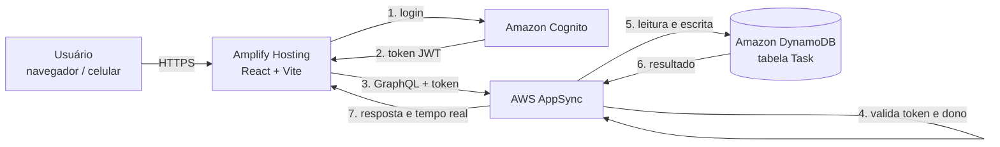

# Projeto: TaskCloud

Este é um projeto de desenvolvimento web que criei para a disciplina de **Sistemas Computacionais em Nuvem**, da **Universidade Católica de Brasília**. O TaskCloud é um gerenciador de tarefas pessoal, com login, dados salvos na nuvem e painel de acompanhamento, construído sobre serviços reais da AWS.

---

## Visualize o projeto

[Aplicação publicada](https://main.d2n7er52laogfm.amplifyapp.com)

[Vídeo de apresentação](COLE_AQUI_O_LINK_DO_VIDEO)

---

## Sobre o projeto

- **Tipo de projeto:** Aplicação web funcional (full stack serverless).
- **Disciplina:** Sistemas Computacionais em Nuvem — Universidade Católica de Brasília.
- **Autor:** Vinícius Luiz
- **Objetivo:** Permitir que cada usuário organize suas tarefas com prazo, prioridade e categoria, acompanhando o progresso em um painel. Todos os dados ficam armazenados na AWS, e cada conta enxerga apenas as próprias tarefas.

---

## Funcionalidades

- Cadastro, login e logout com e-mail e senha (confirmação por e-mail).
- Criar, editar e excluir tarefas (com confirmação).
- Marcar tarefas como concluídas ou pendentes.
- Título, descrição, data de vencimento, prioridade (baixa, média, alta) e categoria.
- Filtros por status e prioridade, pesquisa pelo título e ordenação por prazo, prioridade ou data de criação.
- Destaque visual para tarefas concluídas, pendentes e atrasadas.
- Painel com indicadores atualizados em tempo real: total, pendentes, concluídas e atrasadas.
- Interface em português, responsiva para computador e celular.

---

## Tecnologias e serviços AWS

| Camada | Tecnologia | Função |
|---|---|---|
| Frontend | React, TypeScript, Vite, CSS | Interface da aplicação |
| Hospedagem | **AWS Amplify Hosting** | Build, publicação, CDN e HTTPS |
| Autenticação | **Amazon Cognito** | Cadastro, login e sessão dos usuários |
| API | **AWS AppSync** (GraphQL) | Operações de leitura e escrita, com atualização em tempo real |
| Banco de dados | **Amazon DynamoDB** | Armazenamento das tarefas |
| Infraestrutura | **AWS Amplify Gen 2** | Cria os recursos acima a partir do código (infraestrutura como código) |

---

## Arquitetura

