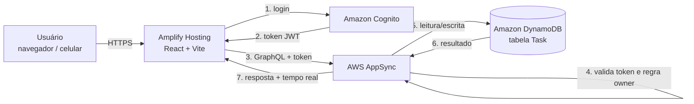

# Arquitetura e caminho dos dados

**Caminho de uma tarefa:** o usuário preenche o modal → o front envia a mutação GraphQL com o token do Cognito → o AppSync confirma quem é o usuário e grava o `owner` → o DynamoDB persiste o item → o AppSync devolve o resultado e notifica a assinatura em tempo real → a lista e os indicadores do painel se atualizam sozinhos.

**Provisionamento:** o código em `amplify/` é convertido pelo Amplify Gen 2 em stacks do CloudFormation (infraestrutura como código).
